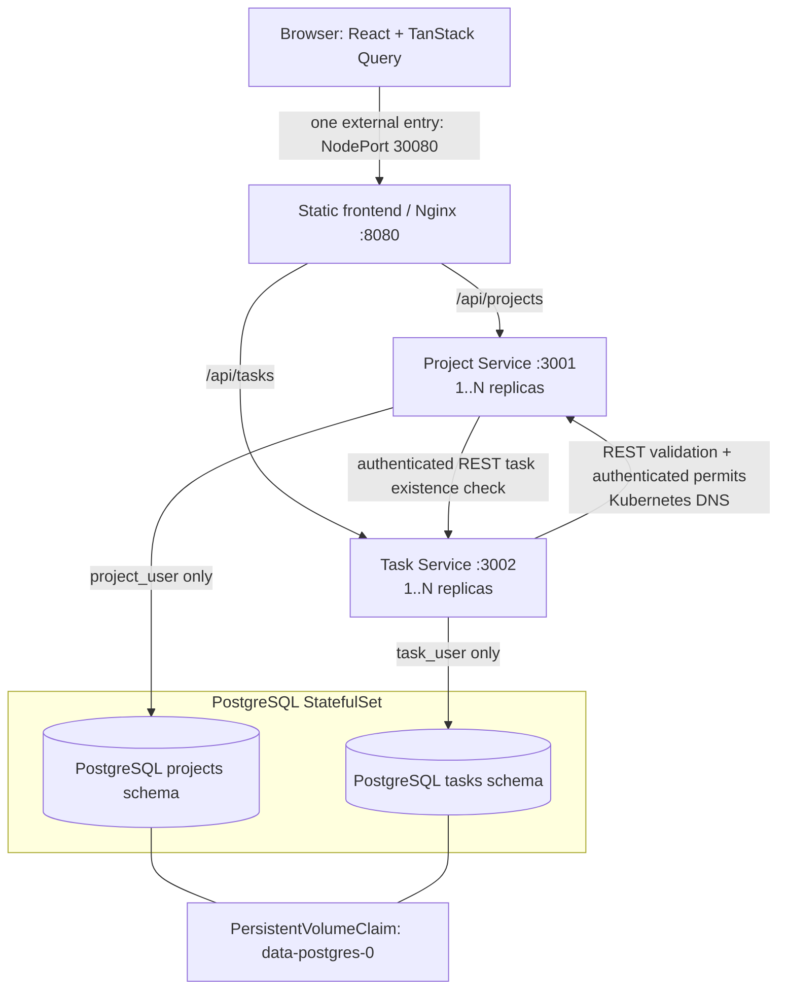

# Component and deployment diagram

Nginx is a prebuilt static web server; only Project Service and Task Service contain custom backend business logic. PostgreSQL runs separately. ClusterIP Services select replicas, and the PVC exists independently of database pods.
